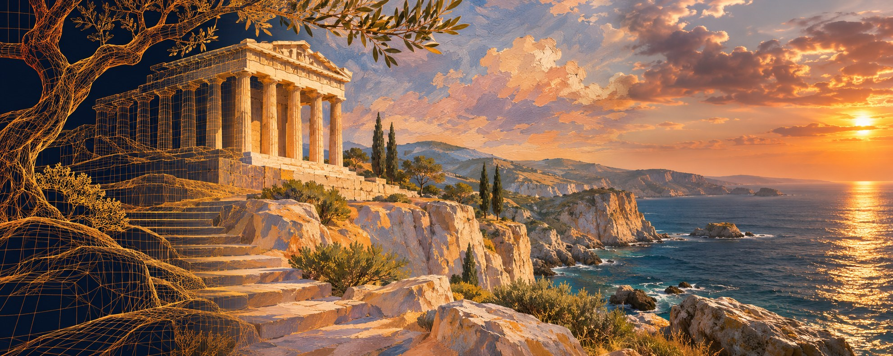

# Filmes em código



[PT](README.md) · [EN](README.en.md) · [ES](README.es.md)

## O que é

Você quer mudar um detalhe do filme e guardar o que já ficou bom. Esta biblioteca mostra como a IA pode escrever as instruções que desenham cada imagem. Se você tem curiosidade e nunca programou, comece por uma demonstração e depois abra o projeto para descobrir como o autor fez aquela cena. Para explorar, basta o navegador.

[Abrir o guia](https://inematds.github.io/filmes-em-codigos-lib/guia/) · [Bibliotecas de estilos e filmes em código](https://inematds.github.io/filmes-em-codigos-lib/guia/#biblioteca) · [Alto realismo em código](https://inematds.github.io/filmes-em-codigos-lib/guia/#realismo)

## O processo, do início ao fim

1. Você abre o guia, escolhe estilo ou alto realismo e assiste a uma demonstração.
2. Você abre o repositório do autor, a página que guarda os arquivos do projeto. Se quiser ajuda para ler o código, cole o pedido abaixo no seu assistente junto com o endereço do projeto.
3. O assistente explica como o detalhe aparece no quadro. Você confere a explicação no filme e no código indicado.
4. Para criar sua cena, você escolhe uma referência. O assistente escreve o programa, o motor calcula um quadro e você compara o resultado com a referência antes de aprovar a sequência.
5. O motor salva os quadros aprovados e o programa de montagem combina os quadros com o áudio.

> Explique como o autor deste projeto desenhou um quadro. Escolha um detalhe que eu consiga reconhecer no filme e mostre onde ele aparece no código.

---

## Instalação técnica

Para ver a biblioteca no seu computador, use Git e Python 3. No terminal, copie o projeto, entre na pasta e inicie o servidor. Depois abra o endereço abaixo.

```sh
git clone https://github.com/inematds/filmes-em-codigos-lib.git
cd filmes-em-codigos-lib
python3 -m http.server 8000
```

[localhost:8000/guia/](http://localhost:8000/guia/)
